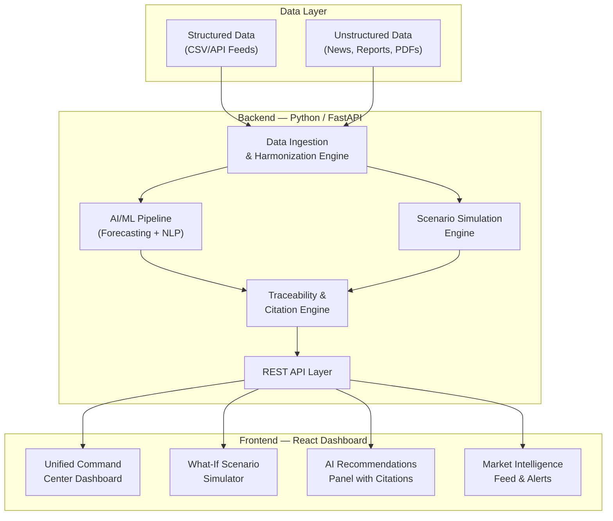

# Ferrero Commodity Pricing & Procurement Intelligence Platform — MVP

> **Validated MVP specification — supersedes conflicting detail below.**
>
> The repository currently contains no implementation, tests, package manifests, Docker files, or Git metadata. This document is therefore an implementation specification, not evidence that the platform already exists. The referenced Ferrero email was not supplied, so the “Extracted Requirements” section below remains provisional until checked against that email.

## Validated MVP Scope

Build a deterministic, demo-ready hazelnut procurement dashboard using synthetic data. The MVP includes:

1. A unified procurement view.
2. Transparent what-if scenario analysis.
3. Traceable, citation-backed recommendations in mock-AI mode.
4. Seeded market alerts and intelligence.

Live Ferrero systems, live external feeds, production authentication, autonomous purchasing, and cloud deployment are deferred. The UI must visibly label the data as **Synthetic demo data** and market signals as **Simulated market signals**. EUR is the reporting currency; USD and TRY may be retained as source currencies.

## Working assumptions

- Origins: Turkey, Italy, and Oregon.
- Currencies: EUR, USD, and TRY.
- Historical period: two years; forecast horizon: 30/60/90 days.
- Six synthetic suppliers and three synthetic warehouses.
- Mock AI is the default and requires no API key.
- A baseline Ridge or seasonal-naive forecast is sufficient for the MVP.
- Prediction bounds must use bootstrap residual intervals or conformal prediction. A model must not claim statistical confidence intervals without a documented method.
- “Real-time” means deterministic alerts generated from seeded data.

## Required data schemas

All dates must be ISO-8601. Every record must have a `source_id`.

- `hazelnut_prices.csv`: `date`, `origin`, `grade`, `price_eur_per_kg`, `source_id`
- `exchange_rates.csv`: `date`, `base_currency`, `quote_currency`, `rate`, `source_id`
- `tariffs.json`: `origin`, `destination`, `effective_from`, `effective_to`, `rate_percent`, `source_id`
- `supplier_contracts.json`: `supplier_id`, `origin`, `valid_from`, `valid_to`, `volume_kg`, `price_eur_per_kg`, `min_take_kg`, `max_take_kg`, `status`, `source_id`
- `demand_forecasts.csv`: `month`, `product_line`, `demand_kg`, `source_id`
- `inventory_levels.csv`: `date`, `warehouse_id`, `origin`, `quantity_kg`, `source_id`
- `logistics_costs.csv`: `route`, `origin`, `destination`, `effective_from`, `cost_eur_per_kg`, `source_id`
- `weather_crop_data.csv`: `date`, `region`, `temperature_c`, `rainfall_mm`, `crop_yield_index`, `source_id`
- `macro_indicators.csv`: `date`, `country`, `indicator`, `value`, `unit`, `source_id`

Market reports must be Markdown files with metadata for `source_id`, `title`, `publisher`, `published_at`, `origin`, and `source_type`. They are synthetic simulations and must not appear to be real publications.

The loader must fail clearly on missing columns, invalid dates, negative quantities, unsupported currencies, and duplicate primary keys. Raw and transformed data must remain distinguishable.

## Calculation rules

- Weighted average price = `sum(price × committed_volume) / sum(committed_volume)`.
- Total exposure = `committed_volume × contract_price`.
- Cost to serve = procurement cost + tariff cost + logistics cost.
- Days of supply = `available_inventory / average_daily_demand`.
- Scenario demand = baseline demand × `(1 + demand_delta_percent / 100)`.
- Scenario supply = baseline supply × `(1 - supply_reduction_percent / 100)`.
- Scenario logistics cost = baseline logistics cost × logistics multiplier.
- FX changes apply only to source records denominated in the affected currency.
- Demand exceeding available supply must be reported as unmet demand, never silently allocated.

Supplier rebalancing is a constrained greedy allocation for this MVP: allocate by lowest landed cost subject to each supplier’s minimum and maximum volumes, then report any unmet demand. A full mathematical optimizer is deferred.

## AI and traceability rules

Implement a provider interface with `AI_PROVIDER=mock` by default. Both mock and optional LLM providers must return:

- action: `BUY`, `HOLD`, `HEDGE`, or `DIVERSIFY`
- summary and concise evidence-based explanation
- rule-based confidence label and score
- evidence objects containing source ID, source type, field/excerpt, and relevance
- `data_as_of` timestamp and limitations

Citation validation must reject unknown source IDs. Do not expose unrestricted chain-of-thought; show concise evidence and decision factors instead. The mock provider must be deterministic and still use real seeded source IDs.

## Required repository additions

In addition to the files listed below, implementation must include:

```text
backend/app/models.py
backend/app/data/schemas.py
backend/tests/
backend/Dockerfile
frontend/Dockerfile
docker-compose.yml
.env.example
README.md
```

`.env.example` must define `AI_PROVIDER=mock`, optional `OPENAI_API_KEY`, `CORS_ORIGINS`, and data paths. ChromaDB, if used, must have a persistent local volume and must not be required for mock mode.

## API acceptance contract

Add `GET /api/health` and retain the planned dashboard, forecast, scenario, advisor, and market endpoints. All endpoints must use typed request/response models, return useful 4xx errors, and expose OpenAPI examples for dashboard, scenario, and advisor responses.

Every dashboard KPI must return value, unit, period, `data_as_of`, and source IDs. Every scenario response must return baseline, scenario, delta EUR, delta percent, supplier allocation, unmet demand, assumptions, and source IDs. Every alert must include severity, trigger value, threshold, timestamp, category, and source IDs.

## Acceptance tests

Automated tests must cover loader validation, KPI formulas, scenario input bounds, scenario directional behavior, supplier capacity constraints, citation validation, alert thresholds, API health, and API error handling.

The following must succeed from a clean checkout:

```bash
docker compose up --build
cd backend && python -m pytest tests -v
cd frontend && npm test -- --run
```

Manual acceptance:

- All four pages load without console or server errors.
- KPIs show EUR, units, period, freshness, and source IDs.
- Forecasts show actuals, forecast, bounds, interval method, and model version.
- Increasing tariffs produces a logically higher cost or an explicitly explained offset.
- Supply reduction can produce an explicit unmet-demand result.
- Advisor responses contain only valid citations and confidence labels.
- Alerts display their trigger and threshold.
- Mock mode works without an API key.
- The demo can be completed in under 10 minutes.

## Deferred features

Defer live APIs, ERP integration, production authentication, automated purchasing, advanced optimization, production-grade forecasting, autonomous alert delivery, and cloud deployment until the deterministic MVP passes the acceptance tests.

## Background & Problem Statement

Ferrero's procurement teams currently make **fragmented decisions** across multiple disconnected data sources when managing **hazelnut commodity pricing and procurement**. Key variables — commodity prices, tariffs, currency exchange rates, supplier contracts, demand forecasts, weather data, and market intelligence — live in separate systems with no unified view. This leads to suboptimal buying decisions, missed opportunities, and an inability to simulate future scenarios.

**The MVP Goal**: Build a working, demo-ready platform that showcases how AI can unify all procurement variables into a single decision environment, integrate structured + unstructured data, provide traceable recommendations, and enable what-if scenario simulation — all within a visually impactful dashboard experience.

---

## Extracted Requirements (from Ferrero's email)

| # | Requirement | MVP Priority |
|---|-------------|-------------|
| 1 | **Unified View** — Single dashboard integrating all variables: commodity prices, tariffs, FX rates, supplier contracts, demand forecasts, inventory, market intel, logistics costs, macro indicators, weather/crop factors | 🔴 Critical |
| 2 | **Structured + Unstructured Data Integration** — Ingest from ERP, procurement platforms, market feeds (structured) AND market reports, commodity outlooks, industry news (unstructured). Harmonize data at different frequencies. | 🔴 Critical |
| 3 | **Reduce AI Hallucinations with Full Traceability** — Source-backed recommendations, confidence indicators, auditability of decisions | 🔴 Critical |
| 4 | **Scenario Simulation / What-If Analysis** — Model tariff changes, currency fluctuations, supply disruptions, demand variations, logistics constraints. Show business & financial impact. | 🟡 High |
| 5 | **AI-Enabled Forecasting & Decision Support** — Predict commodity price movements, forecast procurement costs, identify risks/opportunities, recommend actions, explain reasoning | 🟡 High |
| 6 | **Market Intelligence & External Signal Monitoring** — Real-time market intel & alerts, commodity price trend forecasting, crop yield/weather/supply disruption monitoring, logistics & macro tracking, AI-driven pricing intelligence | 🟡 High |

---

## Proposed Architecture



---

## Proposed Changes

### Component 1 — Data Layer & Seed Data

This is the foundation. Since this is an MVP/demo, we'll use **realistic synthetic data** seeded from publicly available hazelnut market data patterns rather than connecting to live Ferrero systems.

#### [NEW] `backend/data/seed/` — Seed data directory

| File | Purpose |
|------|---------|
| `hazelnut_prices.csv` | Historical hazelnut commodity prices (Turkey, Italy, Oregon origins) — daily/weekly granularity, 2 years |
| `exchange_rates.csv` | EUR/USD, EUR/TRY currency pairs — daily, 2 years |
| `tariffs.json` | Tariff schedules by origin country with effective dates |
| `supplier_contracts.json` | 5-8 mock supplier contracts with pricing tiers, volumes, terms |
| `demand_forecasts.csv` | Monthly demand forecast by product line |
| `inventory_levels.csv` | Weekly inventory snapshots across 3 warehouses |
| `logistics_costs.csv` | Shipping rates by route (Turkey→Italy, Oregon→Germany, etc.) |
| `weather_crop_data.csv` | Temperature, rainfall, crop yield indices for key growing regions |
| `macro_indicators.csv` | CPI, GDP growth, trade balance for key economies |
| `market_reports/` | 5-10 markdown/text files simulating analyst reports, commodity outlooks, industry news |

---

### Component 2 — Backend (Python / FastAPI)

#### [NEW] `backend/requirements.txt`
Core dependencies: `fastapi`, `uvicorn`, `pandas`, `numpy`, `scikit-learn`, `openai` (or local LLM), `sentence-transformers`, `chromadb` (vector store for unstructured data), `pydantic`

#### [NEW] `backend/app/main.py`
FastAPI application entry point. Mounts all routers, configures CORS for the React frontend, and runs startup data loading.

#### [NEW] `backend/app/config.py`
Central configuration — API keys, data paths, model settings, feature flags.

#### [NEW] `backend/app/data/loader.py`
- Loads and harmonizes all CSV/JSON seed data into unified Pandas DataFrames
- Handles different time frequencies (daily prices → weekly inventory → monthly forecasts) through resampling/interpolation
- Creates a unified timeline index

#### [NEW] `backend/app/data/vector_store.py`
- Ingests unstructured market reports into a **ChromaDB** vector store
- Chunks documents, generates embeddings via `sentence-transformers`
- Enables semantic search for RAG (Retrieval-Augmented Generation) to ground AI responses in actual documents

#### [NEW] `backend/app/services/unified_view.py`
- Aggregates all data sources into a single unified view payload
- Computes key KPIs: weighted average price, total exposure, cost-to-serve, days of supply
- Returns time-aligned, multi-variable datasets for the dashboard

#### [NEW] `backend/app/services/forecasting.py`
- **Price Forecasting**: Uses scikit-learn (Ridge/Gradient Boosting) trained on historical price + weather + FX features to predict 30/60/90-day hazelnut price movements
- **Procurement Cost Forecasting**: Combines price forecast with demand forecast and logistics costs
- **Risk Scoring**: Identifies top risk factors (supply disruption probability, FX volatility, tariff change risk)
- All predictions include **confidence intervals** and **feature importance** for traceability

#### [NEW] `backend/app/services/scenario_engine.py`
- **What-If Simulation Engine**: Users adjust variables (tariff %, FX rate, supply volume, demand change, logistics cost multiplier) and the engine recalculates:
  - Total procurement cost impact (Δ$ and Δ%)
  - Optimal supplier mix rebalancing
  - Inventory buffer recommendations
  - Financial P&L impact
- Returns baseline vs. scenario comparison data

#### [NEW] `backend/app/services/ai_advisor.py`
- **AI Recommendation Engine** powered by LLM (OpenAI GPT-4 / local Ollama)
- Uses **RAG pattern**: retrieves relevant market reports from vector store + structured data context → sends to LLM → generates recommendations
- Every recommendation includes:
  - **Source citations** (which report/data point backs the claim)
  - **Confidence score** (0-100%)
  - **Reasoning chain** (step-by-step logic)
  - **Action type** (BUY/HOLD/HEDGE/DIVERSIFY)
- Implements **guardrails** to reduce hallucination: constrained prompts, fact-checking against structured data, refusal when confidence is low

#### [NEW] `backend/app/services/market_intel.py`
- Monitors and aggregates market signals from seeded data
- Generates **alerts** when thresholds are crossed (price spike >5%, FX move >2%, weather anomaly)
- Commodity price trend analysis with momentum indicators
- External signal scoring and ranking

#### [NEW] `backend/app/api/routes/` — API endpoints

| Route File | Key Endpoints | Purpose |
|-----------|--------------|---------|
| `dashboard.py` | `GET /api/dashboard/unified` | Returns complete unified view payload with all KPIs |
| `dashboard.py` | `GET /api/dashboard/kpis` | Key performance indicators summary |
| `forecasting.py` | `GET /api/forecast/prices` | Price predictions with confidence intervals |
| `forecasting.py` | `GET /api/forecast/costs` | Procurement cost forecasts |
| `scenarios.py` | `POST /api/scenarios/simulate` | Run what-if simulation with user parameters |
| `scenarios.py` | `GET /api/scenarios/presets` | Pre-built scenario templates |
| `advisor.py` | `POST /api/advisor/recommend` | Get AI recommendations with citations |
| `advisor.py` | `GET /api/advisor/risks` | Current risk assessment |
| `market.py` | `GET /api/market/signals` | Latest market intelligence signals |
| `market.py` | `GET /api/market/alerts` | Active alerts |
| `market.py` | `GET /api/market/news` | Processed news/report summaries |

---

### Component 3 — Frontend (React + Tailwind + Recharts)

#### [NEW] `frontend/package.json`
Dependencies: `react`, `react-router-dom`, `tailwindcss`, `recharts`, `lucide-react`, `axios`, `date-fns`

#### [NEW] `frontend/src/App.jsx`
Root component with sidebar navigation and routing to all major views.

#### [NEW] `frontend/src/layouts/DashboardLayout.jsx`
Main layout with collapsible sidebar, top header with alerts badge, and content area.

#### [NEW] `frontend/src/pages/UnifiedDashboard.jsx` — **The Hero Page**
The single most impactful screen. A command-center style dashboard with:

| Section | Content | Visual |
|---------|---------|--------|
| **KPI Strip** | Current hazelnut price, 30-day forecast, total exposure ($M), inventory days of supply, FX rate | Large number cards with trend arrows and sparklines |
| **Price Chart** | Interactive multi-line chart: actual price, forecast, confidence band, contract price overlays | Recharts AreaChart with tooltips |
| **Variable Matrix** | Heatmap showing correlation/impact of each variable (tariffs, FX, weather, demand) on procurement cost | Color-coded grid |
| **Supplier Overview** | Contract status, volume utilization, price comparison across suppliers | Horizontal bar chart + table |
| **Risk Radar** | Spider/radar chart showing risk scores across 6 dimensions (supply, FX, tariff, weather, demand, logistics) | Recharts RadarChart |
| **Recent Alerts** | Scrolling feed of latest market signals and threshold breaches | Card list with severity badges |

#### [NEW] `frontend/src/pages/ScenarioSimulator.jsx`
- Interactive parameter sliders for: Tariff change (%), FX rate adjustment, Supply disruption (% reduction), Demand change (%), Logistics cost multiplier
- **Side-by-side comparison**: Baseline vs. Scenario with animated transitions
- Impact summary cards: Total cost Δ, Margin impact, Optimal action
- Ability to save and compare multiple scenarios

#### [NEW] `frontend/src/pages/AIAdvisor.jsx`
- Chat-like interface for asking procurement questions
- Each AI response rendered as a **recommendation card** with:
  - Action badge (BUY / HOLD / HEDGE / DIVERSIFY)
  - Confidence meter (visual gauge)
  - Expandable **"Why?"** section with reasoning chain
  - Expandable **"Sources"** section with clickable citations to underlying data/reports
  - Timestamp and data freshness indicator
- Pre-built quick-action buttons: "Should I buy now?", "What are my top risks?", "Optimize supplier mix"

#### [NEW] `frontend/src/pages/MarketIntelligence.jsx`
- Real-time market signal feed with filtering by category
- Price trend charts with technical indicators
- News/report cards with AI-generated summaries
- Alert configuration panel

#### [NEW] `frontend/src/components/` — Reusable Components

| Component | Purpose |
|-----------|---------|
| `KPICard.jsx` | Metric card with value, trend, sparkline |
| `PriceChart.jsx` | Interactive price + forecast chart |
| `RiskRadar.jsx` | Spider chart for risk dimensions |
| `ScenarioSlider.jsx` | Labeled slider with value display |
| `RecommendationCard.jsx` | AI recommendation with citations |
| `AlertBadge.jsx` | Severity-coded alert indicator |
| `ConfidenceMeter.jsx` | Visual confidence gauge (0-100%) |
| `SourceCitation.jsx` | Expandable citation with link to source |
| `ComparisonTable.jsx` | Baseline vs. scenario comparison |
| `Sidebar.jsx` | Navigation sidebar |

---

## User Review Required

> [!IMPORTANT]
> **LLM Selection**: The AI Advisor component needs a Large Language Model. Options:
> 1. **OpenAI GPT-4** — Best quality, requires API key and has per-token costs
> 2. **Local Ollama (Llama 3)** — Free, runs locally, requires ~8GB RAM, slightly lower quality
> 3. **Mock AI responses** — Pre-scripted responses for demo purposes, zero setup
>
> For the MVP demo, I recommend **Option 3 (Mock AI)** with the architecture wired for easy swap to Option 1 or 2. This eliminates API key dependency and ensures the demo always works reliably.

> [!IMPORTANT]
> **Deployment Target**: Should the MVP be:
> 1. **Local development server** — `npm start` + `uvicorn` (simplest)
> 2. **Docker Compose** — Containerized, one-command startup (recommended for demo portability)
> 3. **Cloud-deployed** — Hosted on a cloud provider for remote access
>
> I recommend **Option 2 (Docker Compose)** for easy demo setup on any machine.

## Open Questions

1. **Hazelnut Origins**: The seed data will cover Turkey, Italy, and Oregon as primary hazelnut origins. Should we include any other specific origins Ferrero sources from?

2. **Currency Pairs**: Planning EUR/USD and EUR/TRY as the primary FX pairs. Any others that are critical for the demo?

3. **Branding**: Should the platform use Ferrero brand colors/logo in the UI, or should it be branded neutrally as a Tech Mahindra solution?

4. **Demo Narrative**: Would you like me to build in a specific demo "story" — e.g., a scenario where Turkish hazelnut supply drops 20% due to frost, showing how the platform detects, alerts, simulates impact, and recommends action?

---

## Verification Plan

### Automated Tests
```bash
# Backend API tests
cd backend && python -m pytest tests/ -v

# Frontend component tests
cd frontend && npm test

# End-to-end smoke test
cd backend && python -m pytest tests/test_e2e.py -v
```

### Manual Verification
- Launch full stack and walk through each dashboard page
- Verify unified dashboard loads all KPI cards with realistic data
- Run 3 different what-if scenarios and confirm results change logically
- Ask the AI advisor 5 different questions and verify citations are present
- Confirm all charts render correctly and are interactive
- Test responsive layout on different screen sizes

### Demo Readiness Checklist
- [ ] All 4 pages load without errors
- [ ] KPI cards show realistic hazelnut market data
- [ ] Price forecast chart displays prediction with confidence band
- [ ] Scenario simulator adjusts output in real-time with sliders
- [ ] AI recommendations include source citations and confidence scores
- [ ] Market alerts fire on threshold breaches
- [ ] Full demo can be walked through in under 10 minutes
